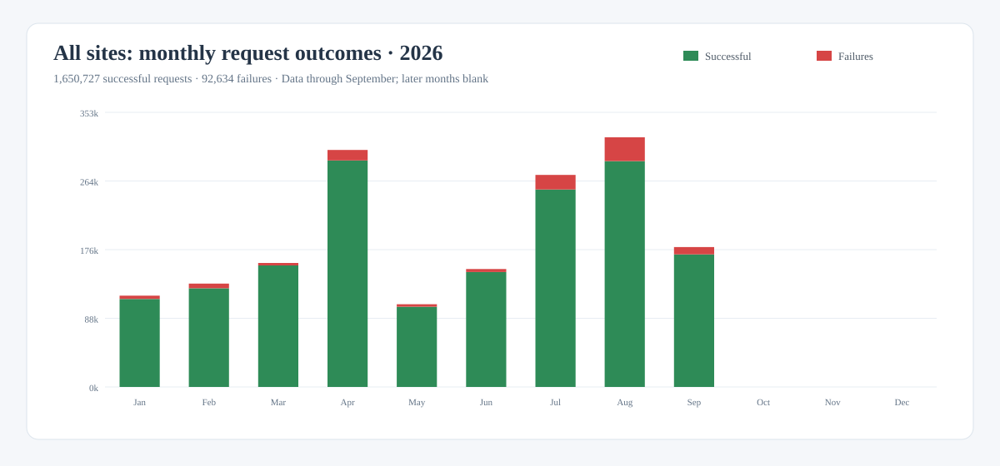
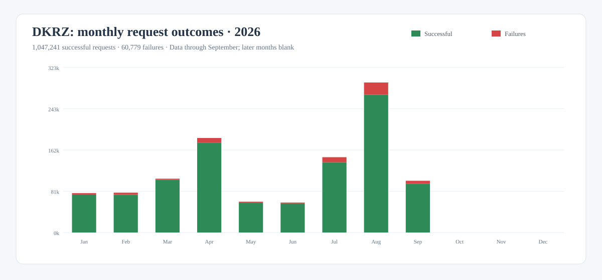
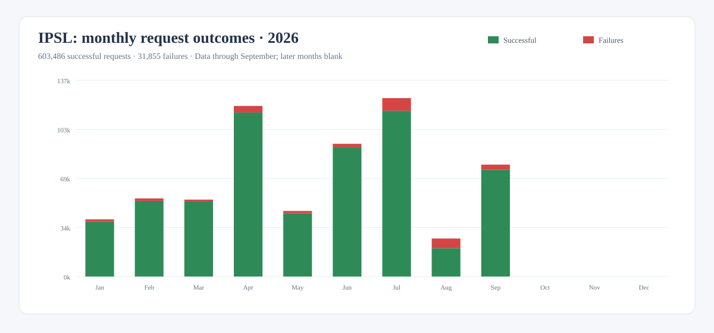
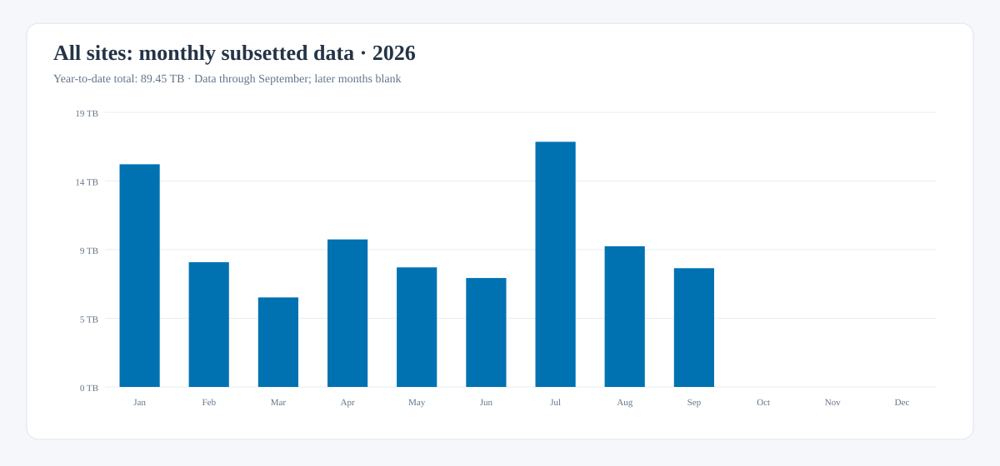
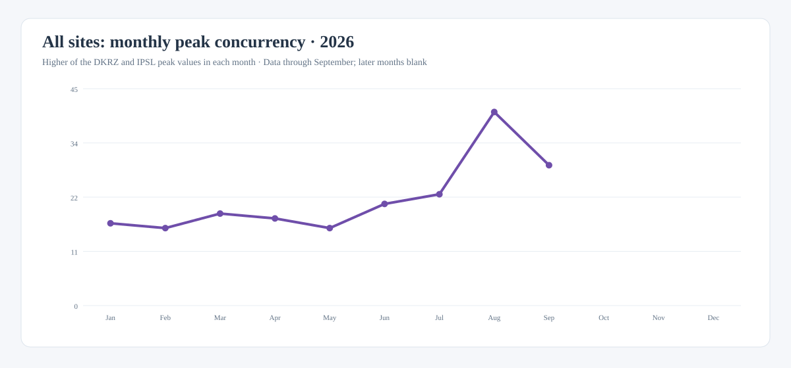

# ROOCS 2026 annual summary to date

This report summarizes monthly usage of the ROOCS subsetting services operated
by DKRZ and IPSL during January–September 2026. Together, the services processed
**1,743,361 requests**, of which **1,650,727 were successful**,
and delivered **89.45 TB** of subsetted data.

| Scope | Requests | Successful | Failures | Subsetted data | Peak concurrency |
| --- | ---: | ---: | ---: | ---: | ---: |
| All sites, January–September | 1,743,361 | 1,650,727 | 92,634 (5.31%) | 89.45 TB | 40 |
| DKRZ | 1,108,020 | 1,047,241 | 60,779 (5.49%) | 56.69 TB | 40 |
| IPSL | 635,341 | 603,486 | 31,855 (5.01%) | 32.76 TB | 29 |

## Monthly request outcomes

The green portion of each bar represents successful requests; failures are
shown in red.

### All sites

[Download this chart as SVG](../downloads/stats/roocs-2026-requests-all.svg){: download }

### DKRZ

[Download this chart as SVG](../downloads/stats/roocs-2026-requests-dkrz.svg){: download }

### IPSL

[Download this chart as SVG](../downloads/stats/roocs-2026-requests-ipsl.svg){: download }

### Understanding the failures

During January–June, of the 33,915 failed requests, 27,737 (81.8%) were classified as wrong
requests. These are mostly caused by users accessing the services directly
through the CDS API rather than through the CDS portal. Without the CDS
catalogue interface to guide and validate available parameters, users commonly
rely on trial and error to discover valid request combinations.

The remaining 6,178 H1 failures (18.2%, or 0.64% of H1 requests) were classified
as internal errors. These include temporary infrastructure problems, such as
full temporary disks or unavailable Lustre storage, as well as genuine
processing defects discovered during operation, including calendar-handling
issues.

For July–September, the [Q3 overview](dashboard-2026.md#q3-july-september-2026)
classifies 39,618 failures as wrong requests and 19,382 as internal errors.
These classifications describe the quarterly export's 59,000 failures; the
monthly site exports record 58,719 failures for the same period. The quarterly
breakdown is therefore reported separately from the monthly totals used above.

Internal failures during the summer also resulted from the activation of Slurm
memory and runtime limits. These issues have now mostly been resolved by
running large jobs in batches.

## Monthly subsetted data

The monthly values combine the data delivered by DKRZ and IPSL.

[Download this chart as SVG](../downloads/stats/roocs-2026-subsetted-data-all.svg){: download }

## Monthly peak concurrency

For each month, overall concurrency is the higher of the DKRZ and IPSL peak
values. The site peaks are not added because they may have occurred at different
times.

[Download this chart as SVG](../downloads/stats/roocs-2026-concurrency-all.svg){: download }

## Data and methodology

Request, failure, and subsetted-data totals are sums of the monthly DKRZ and
IPSL dashboard exports. Successful requests are calculated as total requests
minus failed requests. Peak concurrency is not additive: the combined monthly
series uses the higher site value, and the reporting-period value is its maximum.

Reporting note: 2026 is ongoing. This summary contains the complete monthly
exports currently available for January through September. Totals are derived
from those monthly DKRZ and IPSL exports and will increase as later months are
added. The existing H1 overview reports 970,976 requests and 53.90 TB, whereas
the sum of the monthly site exports is 970,973 requests and 55.19 TB. This page
uses the monthly values so its totals remain consistent with the charts and CSV.
The H1 overview's concurrency of 33 comes from the combined export; following
the method used on these annual pages, the chart instead uses the higher DKRZ or
IPSL peak in each month, producing an H1 peak of 21.

For Q3, the existing overview reports 772,669 requests and 14.02 TB, compared
with 772,388 requests and 34.26 TB from the monthly site exports.
Its combined concurrency peak is 33, while the monthly site exports peak at
40 (DKRZ in August). The September combined ALL export is missing;
both site exports are available and supply September's values in this summary.

[Download the monthly source data as CSV](../downloads/stats/roocs-2026-monthly.csv){: download }
