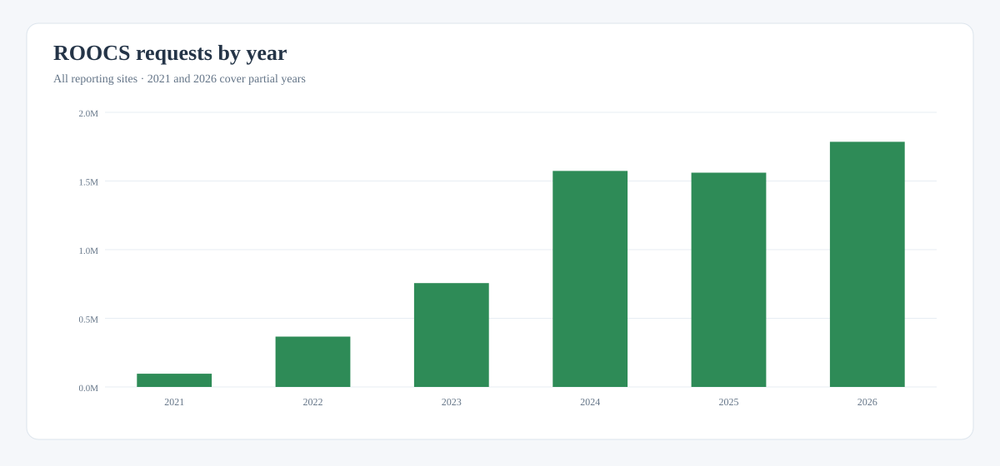
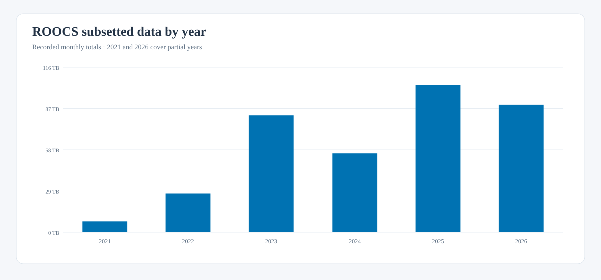

# ROOCS usage by year

This overview shows the total number of requests processed and the recorded
volume of subsetted data for each reporting year. Detailed request outcomes,
site breakdowns, and monthly charts are available from the linked annual pages.

For the latest cached health checks, see [Service status](../status.md).

| Year | Coverage | Requests | Subsetted data |
| --- | --- | ---: | ---: |
| [2021](summary-2021.md) | March–December (recorded) | 94,254 | 7.62 TB |
| [2022](summary-2022.md) | January–December | 357,821 | 27.16 TB |
| [2023](summary-2023.md) | January–December | 738,432 | 81.97 TB |
| [2024](summary-2024.md) | January–December | 1,536,287 | 55.32 TB |
| [2025](summary-2025.md) | January–December | 1,523,415 | 103.30 TB |
| [2026](summary-2026.md) | January–September (year to date) | 1,743,361 | 89.45 TB |

ROOCS is designed to subset large datasets before delivery. Transferred volume
is therefore not a metric to maximize: for equivalent scientific requests,
less data transferred generally means more effective subsetting and lower
network and storage costs.

## Requests

[Download this chart as SVG](../downloads/stats/roocs-all-years-requests.svg){: download }

## Subsetted data

[Download this chart as SVG](../downloads/stats/roocs-all-years-subsetted-data.svg){: download }

## Downloads

[Download monthly DKRZ usage statistics (CSV)](../downloads/stats/dkrz-monthly.csv){: download }

This continuously updated file contains one row per month for **DKRZ only**,
currently covering **2021-03 through 2026-09**. The download address stays
the same when new reporting months are added. IPSL and CEDA are excluded;
an IPSL export may be added separately in future.

The CSV uses semicolons and the following columns:

| Column | Meaning |
| --- | --- |
| `date` | First day of the reporting month, in `YYYY-MM-DD` format. |
| `country` | `GB`, the agreed attribution for CDS gateway traffic; this does not identify the countries of individual CDS users. |
| `requests` | WPS Execute processing requests, including successful and failed jobs. |
| `downloads` | Recorded result-file fetches; repeated fetches are counted separately. |
| `downloads_size` | Recorded transfer volume in MB, using the previous exports' conversion of 1 GB = 1024 MB. Source totals are rounded. |
| `visits` | Distinct users during the month; empty because the dashboards do not provide this information. |

Missing measurements are empty, rather than zero. Download counts and sizes
are unavailable for March–June 2021. The May 2024 download count is incomplete
because May 28–29 are missing from the source exports. The latest year contains
only the available months, without extrapolation.

[Download source and coverage notes](../downloads/stats/dkrz-monthly-notes.txt){: download }

## Comparability

The 2021 series starts in March, and its transfer total reflects the values
recorded in the archived monthly exports; those exports are known to be
incomplete. The 2026 figure currently covers January through
September and will grow as later reports are added.
See the individual annual pages for source-specific notes.
